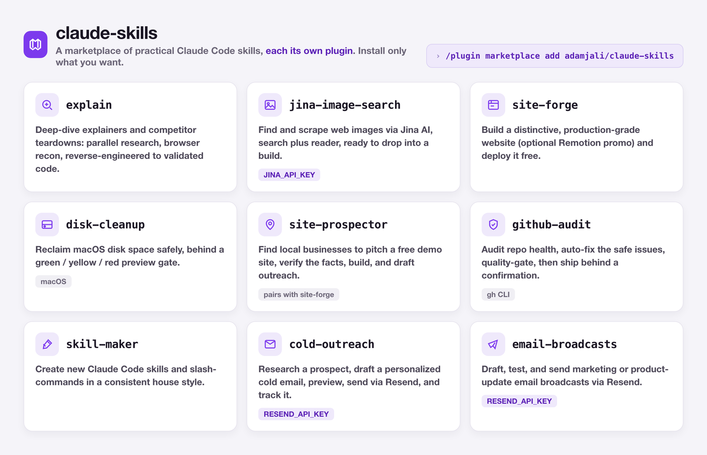
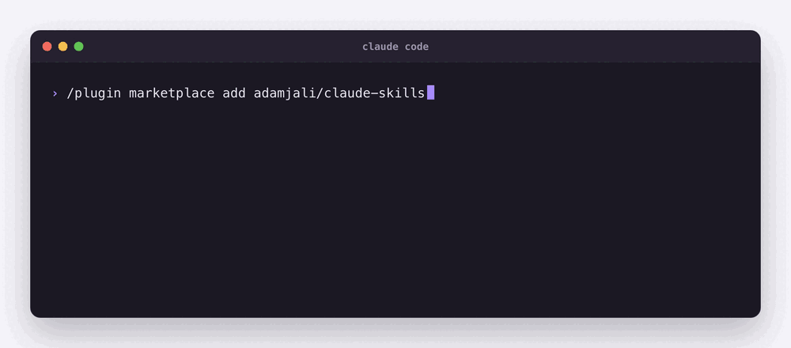
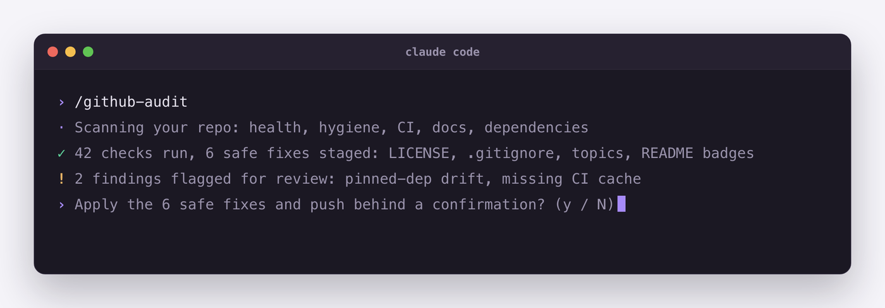

# claude-skills

[](LICENSE)
[](https://code.claude.com/docs/en/plugins)

A marketplace of practical [Claude Code](https://code.claude.com) skills, packaged as installable plugins: research & competitor teardowns, web build/deploy, image search, repo auditing, macOS disk cleanup, prospecting & cold outreach, email broadcasts, and a skill generator. Each skill is its own plugin, so you install only what you want.

> **Requires** [Claude Code](https://code.claude.com) (v2.1+). Everything here is local-first and bring-your-own-key, with no telemetry and no bundled secrets.



## Install

```text
/plugin marketplace add adamjali/claude-skills
/plugin install explain@adamjali
```



After installing, a skill activates automatically when your request matches it, or you can invoke it directly (e.g. `/explain`). List what you have with `/plugin` or `claude plugin list`.

## Skills

| Skill | What it does | Needs |
|-------|--------------|-------|
| `explain` | Deep-dive explanation & competitor/product teardown: parallel research, browser recon, reverse-engineer calculators to validated code | none |
| `jina-image-search` | Find & scrape web images via Jina AI (search + reader) | `JINA_API_KEY` (free; optional for reads) |
| `site-forge` | Build a distinctive production-grade website (+ optional Remotion promo) and deploy it free | optional: `JINA_API_KEY`, deploy CLI |
| `disk-cleanup` | Free up disk space on macOS safely with a green/yellow/red preview gate | macOS |
| `site-prospector` | Find local businesses to pitch a free demo site, verify facts, build via `site-forge`, draft outreach | pairs with `site-forge` |
| `github-audit` | Audit repo health, auto-fix safe issues, quality-gate, and ship behind a confirmation gate | `gh` CLI |
| `skill-maker` | Create new Claude Code skills/slash-commands in a consistent house style | none |
| `cold-outreach` | Research a prospect, draft a personalized cold email, preview, send via Resend, track | `RESEND_API_KEY`; optional `JINA_API_KEY` |
| `email-broadcasts` | Draft, test, and send marketing/product-update email broadcasts via Resend | `RESEND_API_KEY` |

## A skill at work



*Skills gate anything consequential behind a confirmation. Here `github-audit` stages the safe fixes and asks before it touches your repo. Illustrative run.*

## API keys

Some skills call third-party services and read their key from an environment variable. No key is bundled; you bring your own. A skill will tell you if a key is missing and where to get a free one. Set the variable in your shell profile, for example:

```bash
export JINA_API_KEY="your-key"     # free key at https://jina.ai
export RESEND_API_KEY="your-key"   # free key at https://resend.com
```

## License

MIT. See [LICENSE](LICENSE).
